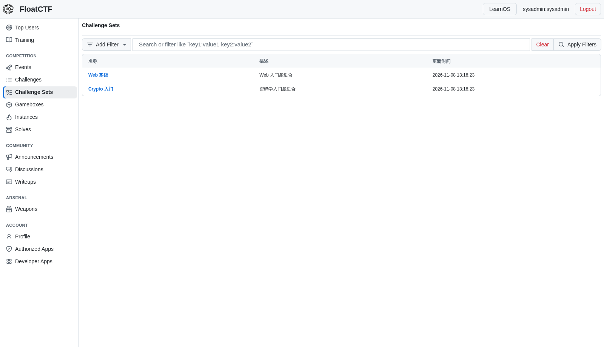
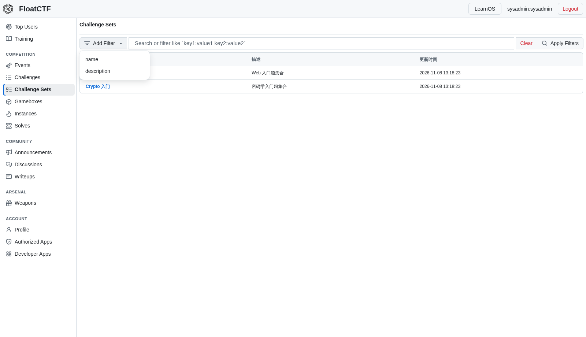
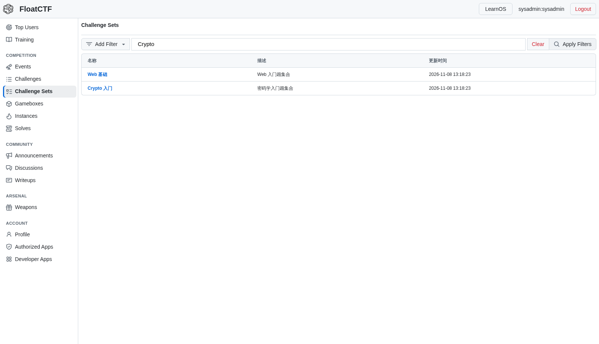
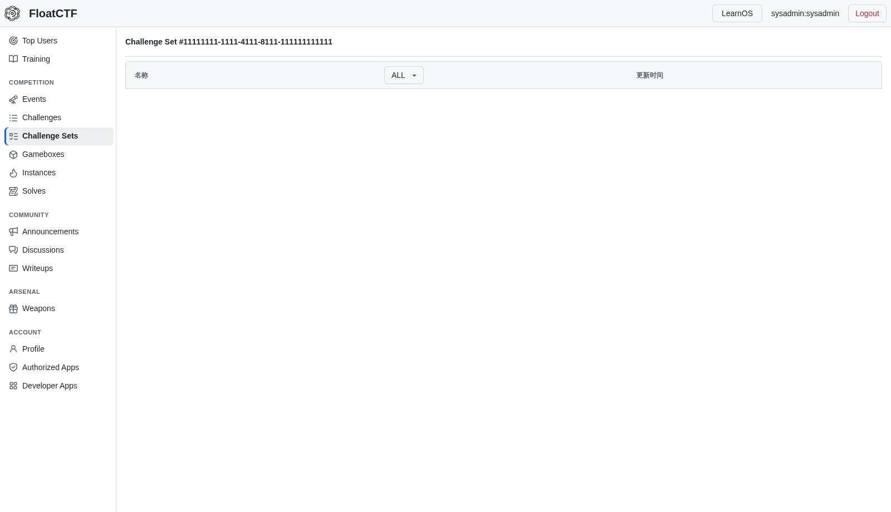
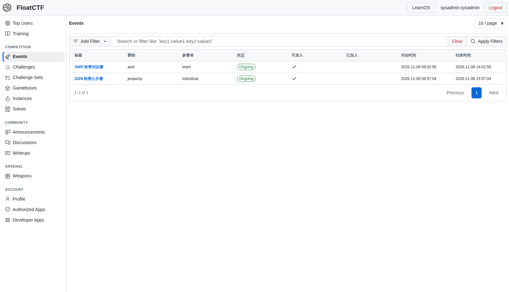
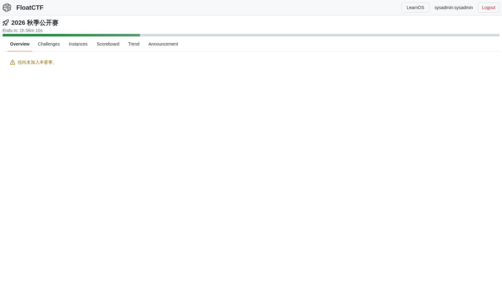
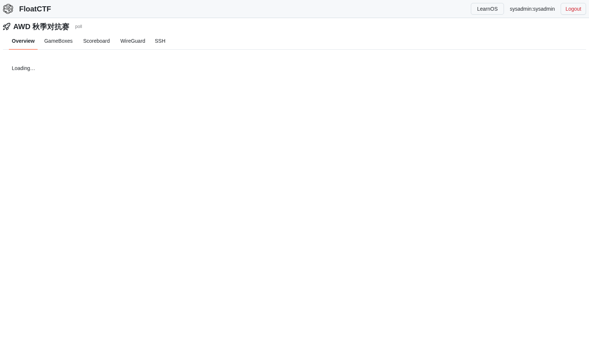

# Default 交互记录（逐页审计）

> 目的：先以 Default 的真实交互为基准，再改 shadcn。每页记录入口、筛选、行点击、
> 弹窗/抽屉、主操作与返回路径；截图保存在本目录。
>
> 本地 Default：`http://10.66.66.2:7780/?frontend=default`（Caddy + 已构建 Default）
> 本地 shadcn：`http://10.66.66.2:13400`
>
> Default 的本地/生产管理端当前都有一个 React #185（Maximum update depth）
> 页面错误；管理端行为以 Default 源码 `GenericTable` 为准，并在本文件注明证据。

## 1. 选手端 · Challenge Sets

入口：`/service/challenge_sets`

### 列表

- 标题：`Challenge Sets`
- 工具栏：
  - `Add Filter`：打开字段菜单（`name` / `description`），不是详情弹窗；
  - 搜索/过滤输入：placeholder 为
    `Search or filter like `key1:value1 key2:value2``；
  - `Clear`：清空过滤并刷新；
  - `Apply Filters`：应用过滤并刷新。
- 表格列：名称、描述、更新时间；三列都可排序。
- **点击名称是普通链接**，进入独立详情页
  `/service/challenge_sets/:id`，不是在当前页开详情 Dialog。
- 行本身没有操作菜单；没有“打开”按钮列。

### Add Filter

- `Add Filter` 打开一个 **ActionMenu 下拉菜单**，列出可筛选字段；
- 选择字段后向输入框插入 `key:` / ` & key:`，焦点回到输入框；
- 不是 modal 对话框。

### 过滤输入

- 输入框保留用户原始过滤表达式（例如 `name:Crypto`）；
- `Clear` / `Apply Filters` 是独立按钮，不是自动即时过滤；
- 过滤由列表重新请求完成，不在前端自造数据。

### 详情页

- 路径：`/service/challenge_sets/:id`
- 标题：`Challenge Set #<id>`
- 内容：题集内题目的表格（名称 / 更新时间等）；
- **详情是独立页**，不是列表页上的 Dialog。

## 2. 管理端 · Challenge Sets（源码审计）

源码：`frontends/default/src/routes/admin/challenge_sets/index.tsx` +
`frontends/default/src/components/Table.tsx`

- 列表：
  - `Add` 按钮；
  - 可勾选批量删除；
  - 每行名称链接到 `/admin/challenge_sets/:id`；
  - 行尾 `...` 操作菜单：`Edit row` / `Delete row`。
- `Add` / `Edit row` 打开 **右侧 Dialog/Drawer**：
  - 字段：名称、描述；
  - `Create` / `Save`；编辑时可删除；
  - 保存失败保留表单，不关闭。
- 题集详情页仍是独立页；详情页里的 `Add Challenges` 使用 **Dialog + GenericTable** 选择题目。
- 结论：管理端“点开 modal 框”指的是 **Add/Edit 行的右侧抽屉**，不是把整行点击改成
  题集内容弹窗。

> 证据：Default 管理端在当前本地/生产构建都会触发 React #185，无法稳定截图；
> 以上来自 Default 的 `GenericTable` 与 challenge_sets 路由源码。选手端交互已实测截图。

## 3. 当前 shadcn 的错误实现（本次要修）

- 选手端：做成了“自定义搜索 + 点击行开题集内容 Dialog”，且删掉了 Default 的
  `Add Filter` / `Clear` / `Apply Filters` 工具栏；
- 管理端：把行点击改成“题集内容弹窗”，而 Default 是行内操作菜单的 Edit 抽屉 +
  名称链接到详情页；
- 结果：交互层级与 Default 不一致，题集详情也不再是独立页。

## 4. 修复口径

- 选手端恢复 Default：
  - FilterBar（Add Filter 菜单 + filter 输入 + Clear + Apply）；
  - 表格三项列；
  - 名称链接到 `/challenge-sets/:id`；
  - 删除列表页的内容 Dialog。
- 管理端恢复 Default：
  - 名称链接详情页；
  - 行操作菜单 Edit/Delete；
  - Add/Edit 使用右侧抽屉；
  - 创建后刷新列表，不自动打开内容弹窗；
  - 题集内容仍在详情页维护；详情页添加题目使用 Dialog。

## 5. 选手端 · Events

入口：`/service/events`

- 工具栏：每页条数（10/20/50/100）、Add Filter、过滤输入、Clear、Apply Filters；
- 表头：标题、赛制、参赛者、状态、可加入、已加入、开始时间、结束时间；
- 标题是链接，进入对应赛制的事件工作区；
- 可加入 / 已加入用勾选表示；
- 没有卡片视图、没有额外的“打开”操作列。

## 6. 选手端 · Event Workspace

### Jeopardy（未加入时）

- 顶部：赛事标题 + 倒计时进度；
- 一级 Tab：`Overview / Challenges / Instances / Scoreboard / Trend / Announcement`；
- 未加入时 Tab 仍然显示，内容区给出「你尚未加入本赛事」提示；不是把整个工作区替换成门禁页。
- 总览是「赛事说明/规则 + 右侧操作」布局，不是跨 Tab 常驻侧栏。

### AWD

- 顶部：赛事标题 + `poll/live`；
- 一级 Tab：`Overview / GameBoxes / Scoreboard / WireGuard / SSH`；
- 内容区按子页切换，不是把全部内容塞进单个 arena 页。

> 当前 shadcn 事件页已按这些 Tab 和总览布局调整；未加入时的 Tab 展示仍需按上图核对。
